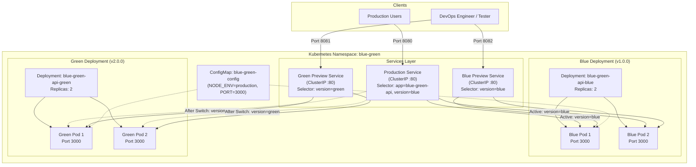
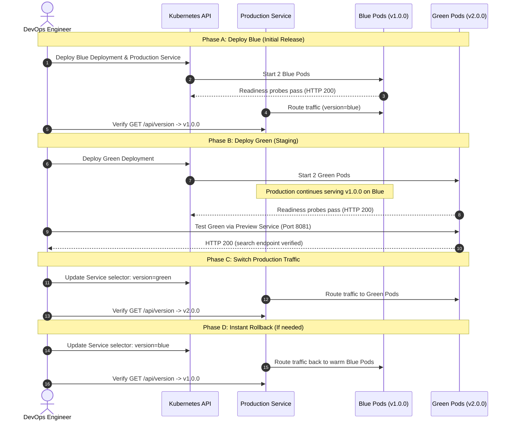

# DeployShift: Blue-Green Deployment of a RESTful Web Application Using Kubernetes and Automated CI/CD

[](https://github.com/ayand/Cloud/actions/workflows/ci.yml)
[](https://nodejs.org/)
[](https://www.docker.com/)
[](https://kubernetes.io/)
[](LICENSE)

---

## 1. Project Title & Abstract

**Project Title**: Blue-Green Deployment of a RESTful Web Application Using Kubernetes and Automated CI/CD (**DeployShift**)

**Abstract**:
In mission-critical cloud applications, service downtime during application upgrades leads to revenue loss and degraded user experience. This project demonstrates a production-grade **Blue-Green Deployment** pipeline for a containerized RESTful API using **Kubernetes** orchestration and **GitHub Actions** CI/CD. Two independent versions of the application—**Blue (v1.0.0)** and **Green (v2.0.0)**—execute concurrently in a dedicated Kubernetes namespace. Production traffic is dynamically routed using Kubernetes Service label selectors. The architecture guarantees zero-downtime releases, pre-release staging validation via isolated preview services, and instantaneous rollbacks without requiring container restarts.

---

## 2. Problem Statement

Traditional application deployments often involve "in-place" updates or sequential rolling updates with notable trade-offs:
- **Downtime & Interrupted Connections**: Dropping active containers before replacements are warm causes HTTP 502/503 errors.
- **Untested Releases in Production**: Applications that pass staging tests may fail under production networking or configuration.
- **High-Latency Rollbacks**: Reverting a failed deployment requires rebuilding containers or waiting for Kubernetes `rollout undo` to cycle pods, taking minutes while users experience errors.
- **State Confusion**: Running mixed versions simultaneously during a rolling release can cause API contract incompatibilities.

---

## 3. Objectives

- **Simultaneous Release Execution**: Run Blue (v1.0.0) and Green (v2.0.0) side-by-side with isolated resources in Kubernetes.
- **Atomic Traffic Switching**: Change 100% of production traffic instantly between releases by modifying the Kubernetes Service label selector.
- **Near-Instantaneous Rollback**: Revert production traffic to the still-warm Blue environment in under one second if Green exhibits issues.
- **Genuine Release Differentiation**: Implement observable feature and API differences between v1 (CRUD baseline) and v2 (search endpoint, release metadata).
- **Automated CI/CD**: Run linting, unit/integration tests, multi-stage Docker builds, and container verification via GitHub Actions.
- **Self-Healing & Health Probes**: Implement HTTP liveness (`/health`) and readiness (`/ready`) probes to gate traffic routing.

---

## 4. Scope and Limitations

### Scope
- RESTful backend application built with Node.js and Express.
- Multi-stage Docker containerization running as non-root user.
- Complete Kubernetes manifests (Namespace, ConfigMap, Deployments, Services).
- Turnkey Windows PowerShell automation scripts for the complete deployment lifecycle.
- Automated testing with Jest, Supertest, and Postman collections.

### Limitations
- **In-Memory Storage**: Student data is stored in memory for demo determinism. Process restarts reset state (documented persistence requirements for production are detailed below).
- **Local Single-Node Cluster**: Designed for Docker Desktop Kubernetes / Kind local development; does not configure cloud load balancers or public TLS certificates.
- **Full Switch Strategy**: Implements 100% atomic cutover rather than canary/percentage-based traffic splitting.

---

## 5. Technology Stack

| Layer | Technology | Version | Purpose |
|---|---|---|---|
| **Runtime & Language** | Node.js / JavaScript (CommonJS) | v20.x | Lightweight, asynchronous backend API runtime |
| **Framework** | Express.js | ^4.21.0 | RESTful HTTP routing, middleware, JSON parsing |
| **Containerization** | Docker | 20.x+ | Multi-stage image build and runtime isolation |
| **Orchestration** | Kubernetes (`kubectl`) | v1.28+ / v1.36 | Container management, Service routing, health probes |
| **Cluster Environment** | Docker Desktop K8s / Kind | Local | Local single-node development Kubernetes cluster |
| **CI/CD** | GitHub Actions | YAML workflow | Automated test execution and container verification |
| **Automated Testing** | Jest & Supertest | ^29.7 / ^6.3 | Unit and integration testing of HTTP routes |
| **API Testing** | Postman / curl / PowerShell | JSON / v2.1 | Manual and automated API validation |
| **Automation Scripts** | Windows PowerShell | 5.1+ | Turnkey operations scripts (`.ps1`) |

---

## 6. Architecture Explanation

### 6.1 Cluster Topology



### 6.2 Architectural Components
1. **Namespace (`blue-green`)**: Provides complete logical isolation from cluster system pods.
2. **ConfigMap (`blue-green-config`)**: Injects non-sensitive environment variables (`PORT: 3000`, `NODE_ENV: production`).
3. **Blue Deployment (`blue-green-api-blue`)**: Runs 2 replicas of `deployshift-api:v1.0.0` with `APP_VERSION=1.0.0` and `APP_ENV=blue`.
4. **Green Deployment (`blue-green-api-green`)**: Runs 2 replicas of `deployshift-api:v2.0.0` with `APP_VERSION=2.0.0` and `APP_ENV=green`.
5. **Production Service (`blue-green-api-production`)**: A `ClusterIP` service directing live traffic to either Blue or Green based on the `version` selector label.
6. **Preview Services (`blue-preview`, `green-preview`)**: Dedicated `ClusterIP` services mapped directly to Blue and Green respectively, allowing staging smoke tests without altering production routing.

---

## 7. Blue-Green Deployment Workflow



---

## 8. Project Directory Structure

```text
Cloud/
├── .github/
│   └── workflows/
│       └── ci.yml               # Automated CI pipeline (lint, test, build, smoke)
├── app/
│   ├── app.js                   # Express application routes and middleware
│   ├── server.js                # HTTP server bootstrap and graceful shutdown
│   ├── middleware/
│   │   ├── errorHandler.js      # Global error and 404 handlers
│   │   └── requestId.js         # Unique UUID request tracing middleware
│   ├── routes/
│   │   └── students.js          # In-memory student CRUD handlers & validation
│   └── tests/
│       └── api.test.js          # Jest & Supertest automated test suite (18 tests)
├── docs/
│   ├── architecture-diagrams.md # Mermaid architecture & sequence diagrams
│   ├── postman_collection.json  # Postman v2.1 collection for all endpoints
│   ├── presentation-outline.md  # 17-slide college presentation outline
│   ├── project-report.md        # Comprehensive academic project report
│   ├── test-cases.md            # Test case specifications and scenario table
│   └── viva-questions.md        # 20 DevOps & Kubernetes viva Q&As
├── k8s/
│   ├── blue-deployment.yaml     # Blue Deployment manifest (v1.0.0, 2 replicas)
│   ├── green-deployment.yaml    # Green Deployment manifest (v2.0.0, 2 replicas)
│   ├── configmap.yaml           # Application environment configuration
│   ├── namespace.yaml           # Dedicated 'blue-green' namespace
│   ├── preview-services.yaml    # Isolated Blue and Green preview services
│   └── production-service.yaml  # Active production routing service
├── scripts/
│   ├── build-images.ps1         # Builds & syncs Docker images to cluster
│   ├── check-prerequisites.ps1  # Verifies Node, npm, Docker, kubectl, cluster
│   ├── cleanup.ps1              # Destructive namespace and resource teardown
│   ├── deploy-blue.ps1          # Initial release: namespace, config, Blue pods
│   ├── deploy-green.ps1         # Deploys Green alongside Blue
│   ├── rollback.ps1             # Instant emergency rollback to Blue
│   ├── switch-to-blue.ps1       # Switches production traffic to Blue
│   ├── switch-to-green.ps1      # Switches production traffic to Green
│   └── verify-deployment.ps1    # 11-point cluster and health verification
├── .dockerignore                # Docker build context exclusions
├── .gitignore                   # Git exclusions (node_modules, coverage, tars)
├── docker-compose.yml           # Local side-by-side container testing
├── Dockerfile                   # Multi-stage, non-root Alpine Dockerfile
├── package.json                 # Node dependencies and test scripts
├── package-lock.json            # Deterministic dependency lockfile
└── README.md                    # Master documentation (this document)
```

---

## 9. Prerequisites & Installation

### Required Software
- **Operating System**: Windows 11 (or Windows 10 with WSL2)
- **Node.js**: v20.x or later ([Download Node.js](https://nodejs.org/))
- **Docker Desktop**: With WSL2 backend and Kubernetes enabled ([Download Docker](https://www.docker.com/))
- **Kubernetes CLI (`kubectl`)**: Bundled with Docker Desktop or installed via `winget install Kubernetes.kubectl`
- **Git**: Installed for version control

### Verifying Prerequisites
Run the automated prerequisite check script:
```powershell
powershell -File scripts/check-prerequisites.ps1
```
Expected output:
```text
[PASS] Node.js - v20.17.0
[PASS] npm - 10.8.2
[PASS] Docker - Docker version 29.8.2
[PASS] kubectl - Client Version: v1.36.1
[PASS] Git - git version 2.46.2.windows.1
[PASS] Docker daemon is running
[PASS] Kubernetes cluster is reachable
All prerequisites passed!
```

---

## 10. Windows PowerShell Setup Instructions

1. Clone or open the project directory in PowerShell:
   ```powershell
   cd c:\Users\ayand\Desktop\Projects\Cloud
   ```
2. Ensure Execution Policy permits local scripts:
   ```powershell
   Set-ExecutionPolicy -Scope Process -ExecutionPolicy Bypass
   ```
3. Install Node.js dependencies:
   ```powershell
   npm install
   ```
4. Execute test suite locally:
   ```powershell
   npm test
   ```

---

## 11. Docker Build & Local Test Commands

### 11.1 Building Images
Build both versioned Docker images:
```powershell
powershell -File scripts/build-images.ps1
```
This builds:
- `deployshift-api:v1.0.0`
- `deployshift-api:v2.0.0`
*(Note: If Docker Desktop uses a Kind node container, `build-images.ps1` automatically synchronizes the tar archives into the containerd `k8s.io` namespace).*

### 11.2 Testing with Docker Compose
Run both versions side-by-side locally:
```powershell
docker compose up -d
```
Test endpoints:
- Blue (v1) on Port 3001: `curl http://localhost:3001/api/version`
- Green (v2) on Port 3002: `curl http://localhost:3002/api/version`

Tear down compose:
```powershell
docker compose down
```

---

## 12. Kubernetes Deployment Commands

### Step 1: Deploy Blue (Initial Release)
```powershell
powershell -File scripts/deploy-blue.ps1
```
What this does:
1. Creates namespace `blue-green` and ConfigMap `blue-green-config`.
2. Deploys Blue Deployment (2 replicas of `deployshift-api:v1.0.0`).
3. Creates `blue-green-api-production` service selecting `version: blue`.
4. Creates preview services for Blue and Green.
5. Waits for rollout completion and verifies pod readiness.

### Step 2: Deploy Green (Staging Release)
```powershell
powershell -File scripts/deploy-green.ps1
```
What this does:
1. Deploys Green Deployment (2 replicas of `deployshift-api:v2.0.0`).
2. Waits for rollout to complete without modifying production routing.
3. Leaves production traffic on Blue.

### Step 3: Run Cluster Verification
```powershell
powershell -File scripts/verify-deployment.ps1
```
Verifies cluster reachability, namespace, both deployments, all 4 pods, service selectors, and endpoint population.

---

## 13. API Endpoint Documentation

Base URLs when forwarded:
- **Production Service**: `http://localhost:8080`
- **Green Preview Service**: `http://localhost:8081`

### 13.1 Core Endpoints

#### `GET /`
Returns application status, release version, and environment.
- **Blue (v1) Response**:
  ```json
  {
    "application": "DeployShift — Blue-Green Deployment Demo API",
    "version": "1.0.0",
    "environment": "blue",
    "status": "running",
    "instanceId": "438271a4",
    "startTime": "2026-10-12T04:40:07.100Z"
  }
  ```
- **Green (v2) Response (adds release metadata)**:
  ```json
  {
    "application": "DeployShift — Blue-Green Deployment Demo API",
    "version": "2.0.0",
    "environment": "green",
    "status": "running",
    "instanceId": "67ae9ca3",
    "startTime": "2026-10-12T04:48:40.113Z",
    "release": {
      "name": "Green Release",
      "codename": "emerald",
      "features": ["enhanced-metadata", "student-search", "pagination-ready"],
      "releasedAt": "2026-10-12T04:48:40.113Z"
    }
  }
  ```

#### `GET /health`
Liveness probe endpoint. Returns process health, uptime, and memory consumption:
```json
{
  "status": "healthy",
  "version": "1.0.0",
  "environment": "blue",
  "uptime": 124.5,
  "timestamp": "2026-10-12T05:00:00.000Z",
  "memoryUsage": 32800000
}
```

#### `GET /ready`
Readiness probe endpoint. Returns readiness state:
```json
{
  "ready": true,
  "version": "1.0.0",
  "environment": "blue",
  "checks": {
    "server": "up",
    "dataStore": "available"
  }
}
```

#### `GET /api/version`
Returns active release metadata, deployment status, and supported capabilities:
- **Blue (v1)**:
  ```json
  {
    "version": "1.0.0",
    "environment": "blue",
    "capabilities": ["crud", "health-checks", "structured-logging"]
  }
  ```
- **Green (v2)**:
  ```json
  {
    "version": "2.0.0",
    "environment": "green",
    "deployment": {
      "strategy": "blue-green",
      "activeSlot": "green",
      "previousSlot": "blue"
    },
    "capabilities": ["crud", "search", "health-checks", "structured-logging"]
  }
  ```

### 13.2 Student CRUD Operations

- `GET /api/students`: Returns list of all student records.
- `GET /api/students/:id`: Returns student record by ID (or 404).
- `POST /api/students`: Creates student record with validation:
  ```json
  // Request
  {
    "name": "Frank Miller",
    "email": "frank@university.edu",
    "course": "Cloud Architecture",
    "year": 2
  }
  // Response (201 Created)
  {
    "id": "6",
    "name": "Frank Miller",
    "email": "frank@university.edu",
    "course": "Cloud Architecture",
    "year": 2
  }
  ```
- `PUT /api/students/:id`: Updates existing student.
- `DELETE /api/students/:id`: Deletes existing student.

### 13.3 v2-Exclusive Endpoint: Student Search

#### `GET /api/students/search?name=Alice`
- In **Blue (v1)**: Returns `404 Not Found` (endpoint does not exist).
- In **Green (v2)**: Returns `200 OK`:
  ```json
  {
    "query": "Alice",
    "count": 1,
    "students": [
      {
        "id": "1",
        "name": "Alice Johnson",
        "email": "alice@university.edu",
        "course": "Computer Science",
        "year": 3
      }
    ],
    "version": "2.0.0"
  }
  ```

---

## 14. Traffic-Switching Procedure

To switch 100% of production traffic to Green (v2.0.0):

1. **Execute Traffic Switch Script**:
   ```powershell
   powershell -File scripts/switch-to-green.ps1
   ```
2. **What Happens Behind the Scenes**:
   - The script verifies that Green pods are ready (`ready: true`).
   - Executes:
     ```powershell
     kubectl set selector service blue-green-api-production -n blue-green "app=blue-green-api,version=green"
     ```
   - Kubernetes immediately updates the Service EndpointSlice.
   - Traffic flows to the warm Green pods with **zero downtime**.
3. **Verify Active Traffic**:
   ```powershell
   kubectl port-forward svc/blue-green-api-production -n blue-green 8080:80
   curl http://localhost:8080/api/version
   ```
   Output: `{"version":"2.0.0","environment":"green",...}`

---

## 15. Rollback Procedure

If Green produces runtime errors or unexpected behavior:

1. **Execute Rollback Script**:
   ```powershell
   powershell -File scripts/rollback.ps1
   ```
2. **What Happens Behind the Scenes**:
   - Checks if Blue pods are still running and healthy.
   - Executes:
     ```powershell
     kubectl set selector service blue-green-api-production -n blue-green "app=blue-green-api,version=blue"
     ```
   - Traffic is redirected back to Blue in **milliseconds**.
3. **Rollback vs. Rollout Undo**:
   - In blue-green, **rollback** modifies the Service selector. The Blue pods were never stopped and are immediately ready to serve requests.
   - A standard Kubernetes `rollout undo` must terminate and recreate pods, incurring initialization lag and cold-start risks.

---

## 16. CI/CD Workflow Explanation

The repository includes an automated pipeline in `.github/workflows/ci.yml`:
1. **Quality Gates**:
   - Runs `npm ci` for deterministic dependencies.
   - Executes `npm run lint`.
   - Runs all Jest tests with coverage reporting.
2. **Container Build & Verification**:
   - Builds both `v1.0.0` and `v2.0.0` Docker images.
   - Launches ephemeral Docker containers on runner ports 3001 and 3002.
   - Verifies HTTP `/health` and `/api/version` endpoints return 200 OK.
   - Tears down ephemeral test containers.
3. **Production Deployment Security**:
   - Kubernetes deployments require a cluster secret (`KUBE_CONFIG`).
   - Uses GitHub Environments (`environment: production`) with manual approval gates to ensure release control.

---

## 17. Test Cases & Expected Results

### 17.1 Automated Unit & Integration Tests (18 Cases)
| # | Test | Endpoint | Method | Expected Status |
|---|---|---|---|---|
| 1 | App root info | `/` | GET | 200 OK |
| 2 | Liveness probe | `/health` | GET | 200 OK |
| 3 | Readiness probe | `/ready` | GET | 200 OK |
| 4 | Version metadata | `/api/version` | GET | 200 OK |
| 5 | List students | `/api/students` | GET | 200 OK |
| 6 | Get student by ID | `/api/students/1` | GET | 200 OK |
| 7 | Get missing student | `/api/students/999` | GET | 404 Not Found |
| 8 | Create student (valid) | `/api/students` | POST | 201 Created |
| 9 | Missing name validation | `/api/students` | POST | 400 Bad Request |
| 10 | Invalid email validation | `/api/students` | POST | 400 Bad Request |
| 11 | Invalid year validation | `/api/students` | POST | 400 Bad Request |
| 12 | Empty body validation | `/api/students` | POST | 400 Bad Request |
| 13 | Update student | `/api/students/1` | PUT | 200 OK |
| 14 | Update non-existent | `/api/students/999` | PUT | 404 Not Found |
| 15 | Update invalid body | `/api/students/1` | PUT | 400 Bad Request |
| 16 | Delete student | `/api/students/1` | DELETE | 200 OK |
| 17 | Delete non-existent | `/api/students/999` | DELETE | 404 Not Found |
| 18 | Unknown route | `/api/unknown` | GET | 404 Not Found |

### 17.2 Deployment Scenarios Verified in Cluster
- **Scenario 1 (Blue Active)**: Verified `GET /api/version` returns `v1.0.0`.
- **Scenario 2 (Green Coexistence)**: Both Blue and Green pods running simultaneously; production remains on Blue.
- **Scenario 3 (Traffic Switch)**: Service selector updated to `green`; requests return `v2.0.0` and search endpoint is active.
- **Scenario 4 (Validation Gate)**: Script guards against switching if target pods are not fully ready.
- **Scenario 5 (Instant Rollback)**: Rollback script reverts selector to `blue` with zero pod restarts.
- **Scenario 6 (Readiness Isolation)**: Pod failure or restart automatically removes the pod from endpoints before serving user traffic.

---

## 18. Troubleshooting Guide

| Symptom | Probable Cause | Corrective Action |
|---|---|---|
| `ErrImageNeverPull` on Pods | Image tag not in local containerd namespace | Run `powershell -File scripts/build-images.ps1`. The script imports images directly into containerd. |
| `kubectl cluster-info` fails | Docker Desktop Kubernetes is stopped | Open Docker Desktop Settings → Kubernetes → Check "Enable Kubernetes" → Apply & Restart. |
| Port 8080 already in use | Stale `kubectl port-forward` running | Find process with `Get-Process kubectl` and stop it via `Stop-Process -Name kubectl`. |
| `kubectl patch` syntax error in PowerShell | PowerShell quote stripping | Use `kubectl set selector service blue-green-api-production -n blue-green "app=blue-green-api,version=green"`. |
| Script execution disabled | PowerShell ExecutionPolicy | Run `Set-ExecutionPolicy -Scope Process -ExecutionPolicy Bypass`. |

---

## 19. Security Considerations

1. **Non-Root User**: Container runs as user `appuser` (UID 1000) defined in Alpine Linux, minimizing host vulnerability exposure.
2. **No Hardcoded Secrets**: Secrets and configurations are externalized into Kubernetes ConfigMaps.
3. **Resource Requests & Limits**: Each pod is capped at 200m CPU and 128Mi Memory, preventing noisy neighbors and cluster resource exhaustion.
4. **Input Sanitization**: Request payloads undergo strict validation to prevent injection or malformed data states.
5. **Private ClusterIP Services**: Application services are not exposed to the public internet by default, requiring port-forwarding or an Ingress controller.

---

## 20. Future Enhancements

1. **Canary Deployments with Service Mesh**: Implement Istio or Argo Rollouts to support canary routing (e.g., 90% Blue / 10% Green) before full cutover.
2. **Persistent Database Integration**: Connect to PostgreSQL using Flyway/Liquibase expand-and-contract schema migrations.
3. **Prometheus & Grafana Observability**: Add Prometheus metric exporters (`/metrics`) for real-time monitoring of latency, request rates, and error percentages.
4. **Automated Rollback on Error Thresholds**: Implement Prometheus alerts that trigger automatic rollback scripts if HTTP 5xx error rates exceed 1%.

---

## 21. Conclusion

The **DeployShift** project illustrates an end-to-end, reproducible implementation of the Blue-Green deployment pattern using industry-standard DevOps tools: Node.js, Docker, Kubernetes, and GitHub Actions. By leveraging Kubernetes Services and label selectors as an atomic routing switch, software engineering teams achieve zero downtime, safe pre-release validation, and sub-second rollback capabilities.

---

## License
This project is open-source and available under the [MIT License](LICENSE).
