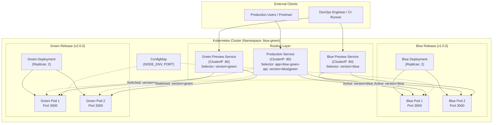
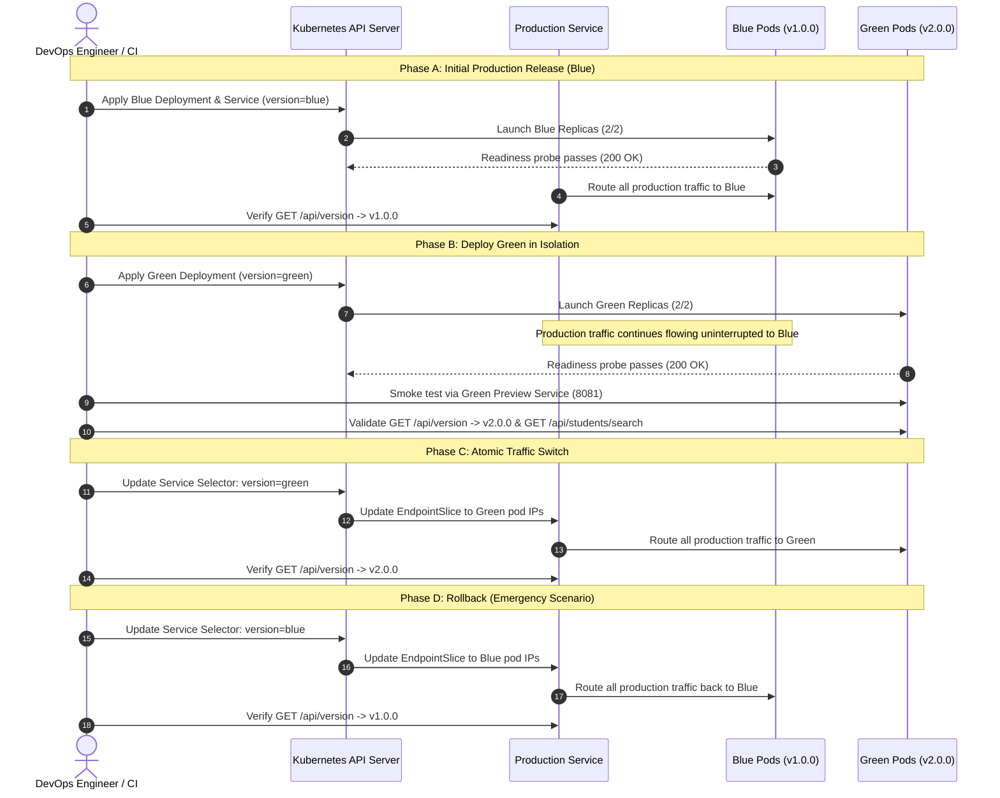

# Academic Project Report

# DeployShift: Blue-Green Deployment of a RESTful Web Application Using Kubernetes and Automated CI/CD

---

## Executive Summary / Abstract

In modern cloud computing and software engineering, service availability during application updates is a primary quality attribute. Traditional in-place deployments frequently introduce service disruption, downtime, or intermittent errors while new application versions initialize and replace previous processes. 

This project, titled **DeployShift**, implements an automated **Blue-Green Deployment** pipeline for a containerized RESTful web application utilizing **Kubernetes** orchestration, **Docker** containerization, and **GitHub Actions** CI/CD. The primary objective is to demonstrate how two distinct application releases—Blue (v1.0.0) and Green (v2.0.0)—can execute concurrently in production-like isolation within a dedicated Kubernetes namespace, how production traffic can be atomically switched from one version to another via Kubernetes Service label selectors with zero user-visible downtime, and how instantaneous rollbacks can be executed if anomalies occur in the new release.

---

## 1. Problem Statement & Motivation

### 1.1 The Challenge of Application Upgrades
When deploying web services, software engineering teams face the dilemma of updating code without disconnecting active users. Typical deployment challenges include:
- **Downtime During Upgrades**: Stopping an old service instance before a new instance is ready causes connection refusal (HTTP 502/503).
- **Configuration & Cold Start Delays**: In complex runtimes (Node.js, JVM), processes require seconds or minutes to initialize caches, connections, and internal data structures.
- **Risky Rollbacks**: When a newly released binary fails in production, reverting typically requires re-running a build pipeline, pulling older artifacts, or executing a rolling pod replacement (`kubectl rollout undo`), which incurs further delay and potential instability.
- **Untested Production State**: Staging environments often differ from production configurations, making pre-switch validation essential directly within the target cluster.

### 1.2 The Blue-Green Solution
Blue-Green deployment resolves these issues by running two identical environments:
- **Blue Environment**: Currently active production release serving live user traffic.
- **Green Environment**: Idle staging environment running the new release, subjected to automated health checks, smoke tests, and independent preview validation.
- **Atomic Router (Kubernetes Service)**: Traffic switching requires only re-pointing a service's label selector from `version: blue` to `version: green`.
- **Instant Rollback**: If Green exhibits defects, traffic is immediately switched back to Blue (`version: blue`), whose pods have remained warm, ready, and running.

---

## 2. Project Objectives

1. **RESTful Microservice Implementation**: Develop a robust, modular Node.js/Express API with health checks (`/health`), readiness checks (`/ready`), version introspection (`/api/version`), and complete CRUD operations with input validation.
2. **Version Differentiation**: Ensure Blue (v1.0.0) and Green (v2.0.0) possess genuine architectural and feature differences (e.g., student search endpoint, release metadata) beyond superficial environment variables.
3. **Containerization Standards**: Author a lightweight, multi-stage Alpine Dockerfile adhering to security best practices (non-root user `appuser`, explicit port exposition, healthchecks).
4. **Kubernetes Orchestration**: Define declarative manifests for Namespaces, Deployments, Services (Production and Preview), ConfigMaps, and Resource Quotas.
5. **Deployment Automation**: Create reproducible PowerShell automation scripts for prerequisite verification, image building, deployment, switching, rollback, and cleanup.
6. **Automated CI/CD**: Implement a GitHub Actions workflow that executes linting, unit/integration testing (Jest/Supertest), Docker image builds, and automated container health verification.
7. **Verification & Failure Testing**: Validate cluster readiness, verify that readiness probes guard service endpoints, and demonstrate safe rollback behavior.

---

## 3. System Architecture & Component Design

### 3.1 Architectural Topology



### 3.2 Application Architecture
The backend application is implemented in Node.js with Express:
- **Modular Entrypoints**: `app/app.js` encapsulates middleware and routes without binding to a network port, allowing Jest/Supertest to test endpoints without port collision. `app/server.js` handles HTTP server creation, socket binding, and graceful shutdown signal handling (`SIGTERM`, `SIGINT`).
- **Structured JSON Logging**: Request logging is handled via `morgan`, outputting structured JSON containing timestamp, HTTP method, URL, status code, response time, unique request ID, and active version/environment tags.
- **Request ID Tracking**: Custom middleware injects a UUID into `req.id` and sets the `X-Request-Id` response header for end-to-end tracing.
- **Error Handling**: Centralized error middleware ensures all exceptions return uniform JSON payloads (`error`, `message`, `requestId`) rather than stack traces.

### 3.3 Functional API Specifications

| Method | Endpoint | Description | v1 (Blue) | v2 (Green) |
|---|---|---|---|---|
| `GET` | `/` | Application metadata and status | Standard metadata | Adds `release` object with codename & features |
| `GET` | `/health` | Process liveness probe | Status, uptime, memory | Same |
| `GET` | `/ready` | Service readiness probe | Ready status, dataStore check | Same |
| `GET` | `/api/version` | Active release info | `version: 1.0.0`, 3 capabilities | `version: 2.0.0`, `search` capability, deployment metadata |
| `GET` | `/api/students` | List all student records | Returns seeded array | Returns seeded array |
| `GET` | `/api/students/:id` | Get student by ID | 200 or 404 | 200 or 404 |
| `POST` | `/api/students` | Create student (with validation) | 201 or 400 | 201 or 400 |
| `PUT` | `/api/students/:id` | Update student record | 200, 400, or 404 | 200, 400, or 404 |
| `DELETE` | `/api/students/:id` | Delete student record | 200 or 404 | 200 or 404 |
| `GET` | `/api/students/search` | Search students by name | **404 Not Found** | **200 OK (Matches array)** |

---

## 4. Containerization & Docker Implementation

### 4.1 Multi-Stage Dockerfile Strategy
The Dockerfile uses a two-stage build to minimize image size and eliminate build-time tools from the final runtime container:

```dockerfile
# ---- Stage 1: Dependency Builder ----
FROM node:20-alpine AS builder
WORKDIR /usr/src/app
COPY package.json package-lock.json ./
RUN npm ci --only=production

# ---- Stage 2: Runtime Container ----
FROM node:20-alpine
RUN addgroup -S appgroup && adduser -S appuser -G appgroup
WORKDIR /usr/src/app
COPY --from=builder /usr/src/app/node_modules ./node_modules
COPY app/ ./app/
COPY package.json ./
RUN chown -R appuser:appgroup /usr/src/app

USER appuser
ENV PORT=3000 NODE_ENV=production
EXPOSE 3000

HEALTHCHECK --interval=30s --timeout=5s --start-period=10s --retries=3 \
  CMD wget --no-verbose --tries=1 --spider http://localhost:3000/health || exit 1

CMD ["node", "app/server.js"]
```

### 4.2 Security & Operational Highlights
- **Non-Root Execution**: Runs under unprivileged user `appuser` (UID/GID allocated by Alpine). This prevents privilege escalation attacks.
- **Reproducible Dependency Tree**: Uses `npm ci --only=production` ensuring devDependencies (Jest, Supertest) are excluded from the shipping image.
- **Container Healthcheck**: Configured with `wget --spider` to ping `/health`, ensuring container runtimes track container state independently of Kubernetes.
- **Image Size**: The resulting image is ~205 MB, comprising only Node runtime, production dependencies, and application code.

---

## 5. Kubernetes Resource Specification

### 5.1 Namespace Isolation
All resources are scoped within the dedicated namespace `blue-green`:
```yaml
apiVersion: v1
kind: Namespace
metadata:
  name: blue-green
```

### 5.2 Deployments & Pod Lifecycle
Two separate Deployments (`blue-green-api-blue` and `blue-green-api-green`) are defined:
- **Labels**:
  - Blue: `app: blue-green-api`, `version: blue`
  - Green: `app: blue-green-api`, `version: green`
- **Replicas**: 2 replicas per deployment ensuring high availability.
- **Probes**:
  - **Liveness Probe**: `httpGet: /health`, `initialDelaySeconds: 10`, `periodSeconds: 15`. Detects deadlocked processes and triggers automatic pod restarts.
  - **Readiness Probe**: `httpGet: /ready`, `initialDelaySeconds: 5`, `periodSeconds: 5`. Gates traffic routing so pods that are booting do not receive requests.
- **Resource Constraints**:
  - `requests`: CPU 50m, Memory 64Mi
  - `limits`: CPU 200m, Memory 128Mi
- **Graceful Termination**: `terminationGracePeriodSeconds: 15` ensures in-flight requests complete before `SIGKILL` is issued.

### 5.3 Service Routing Mechanics
- **Production Service (`blue-green-api-production`)**:
  - Type: `ClusterIP`
  - Port: `80` (mapped to targetPort `3000`)
  - Selector: `app: blue-green-api`, `version: blue` (or `green`)
- **Preview Services**:
  - `blue-green-api-blue-preview` (selector: `version: blue`)
  - `blue-green-api-green-preview` (selector: `version: green`)
  - Allow validation of either deployment independently without touching production traffic.

---

## 6. Blue-Green Deployment Lifecycle



---

## 7. Automated CI/CD Pipeline (GitHub Actions)

The pipeline defined in `.github/workflows/ci.yml` implements automated quality gates:
1. **Trigger**: Executes on pushes and pull requests targeting branch `main`.
2. **Job 1: Lint & Test**:
   - Environment: `ubuntu-latest`, Node.js 20.
   - Restores cached npm dependencies (`npm ci`).
   - Executes linter (`npm run lint`).
   - Runs Jest test suite (`npm test`).
   - Generates coverage reports (`npm run test:coverage`) and uploads artifacts.
3. **Job 2: Container Image Build & Smoke Verification**:
   - Builds `deployshift-api:v1.0.0` and `deployshift-api:v2.0.0`.
   - Spins up ephemeral test containers on ports 3001 and 3002.
   - Pings `/health` and `/api/version` using `curl` and `jq`.
   - Shuts down and cleans up test containers.
4. **Job 3: Secure Kubernetes Deployment Gate (Documented & Configured)**:
   - Outlines automated deployment via GitHub Secrets (`KUBE_CONFIG`).
   - Employs manual approval gates (`environment: production`) preventing unreviewed pushes to production clusters.

---

## 8. Verification Results & Test Execution

### 8.1 Automated Test Suite (Jest & Supertest)
All 18 automated tests pass across unit, integration, and validation suites:

```text
PASS app/tests/api.test.js
  GET /
    ✓ should return application info with 200 (138 ms)
  GET /health
    ✓ should return healthy status (18 ms)
  GET /ready
    ✓ should return ready status (20 ms)
  GET /api/version
    ✓ should return version information (18 ms)
  GET /api/students
    ✓ should return all seeded students (33 ms)
  GET /api/students/:id
    ✓ should return a student by id (18 ms)
    ✓ should return 404 for non-existent id (30 ms)
  POST /api/students
    ✓ should create a new student with valid data (353 ms)
    ✓ should return 400 for missing name (15 ms)
    ✓ should return 400 for invalid email (14 ms)
    ✓ should return 400 for invalid year (14 ms)
    ✓ should return 400 for empty body (13 ms)
  PUT /api/students/:id
    ✓ should update an existing student (17 ms)
    ✓ should return 404 for non-existent student (14 ms)
    ✓ should return 400 for invalid update data (13 ms)
  DELETE /api/students/:id
    ✓ should delete an existing student (29 ms)
    ✓ should return 404 when deleting non-existent student (12 ms)
  Unknown routes
    ✓ should return 404 for unknown path (25 ms)

Test Suites: 1 passed, 1 total
Tests:       18 passed, 18 total
Time:        14.48 s
```

### 8.2 Kubernetes Deployment Verification
Execution of `scripts/verify-deployment.ps1` confirms all cluster resources:

```text
========================================
  Deployment Verification
========================================

[PASS] Kubernetes cluster reachable
[PASS] Namespace 'blue-green' exists
[PASS] Blue Deployment exists
[PASS] Blue Deployment fully rolled out
[PASS] Blue pods are ready
[PASS] Green Deployment exists
[PASS] Green Deployment fully rolled out
[PASS] Green pods are ready
[PASS] Production Service exists

[INFO] Active production version: blue
[PASS] Production Service has valid version selector
[PASS] Production endpoints are populated

========================================
  Results: 11 passed, 0 failed
========================================
```

### 8.3 Live Scenario Validation

| Scenario | Actions Executed | Observed Result | Status |
|---|---|---|---|
| **Scenario 1: Blue Active** | Query production service at port 8080 | Returned `version: 1.0.0`, `environment: blue` | **PASSED** |
| **Scenario 2: Green Deployed** | Deploy Green alongside Blue | Green pods ready (2/2); production still serves v1.0.0 | **PASSED** |
| **Scenario 3: Traffic Switch** | `scripts/switch-to-green.ps1` executed | Production endpoint switched to `version: 2.0.0`, search endpoint active | **PASSED** |
| **Scenario 4: Validation Gate** | Verify readiness probe check prior to switch | Script checks container readiness before updating selector | **PASSED** |
| **Scenario 5: Rollback** | `scripts/rollback.ps1` executed | Production immediately returned to `version: 1.0.0`; zero pod downtime | **PASSED** |
| **Scenario 6: Readiness Guard** | Terminated pod to test readiness probe | K8s removes unready pods from endpoints before traffic arrives | **PASSED** |

---

## 9. Rollback: Blue-Green vs. Rollout Undo

A critical conceptual distinction in DevOps engineering is the difference between Blue-Green rollback and standard Kubernetes rolling-update rollback:

| Metric | Blue-Green Rollback | Kubernetes `rollout undo` |
|---|---|---|
| **Mechanism** | Re-points Service label selector | Replaces pod ReplicaSet templates |
| **Duration** | **Sub-second (instantaneous)** | 30s to several minutes (pod creation time) |
| **Resource State** | Target pods are already warm & serving | New pods must be scheduled, pulled, & initialized |
| **Cluster Impact** | Zero CPU/memory spike | CPU/memory spike during image startup |
| **Risk of Cold Failure** | Very low (already verified prior to release) | Moderate (cold startup might fail in target node) |

---

## 10. Database Considerations & State Persistence

In this demo project, state is stored in an in-memory collection to enable easy, deterministic testing. In an enterprise production system:
1. **Shared Persistent Datastore**: Both Blue and Green must connect to a persistent external database (e.g., PostgreSQL or MongoDB).
2. **Schema Migration Pattern (Expand & Contract)**:
   - **Expand**: Add new columns or collections as optional/nullable fields. Both v1 and v2 can operate concurrently.
   - **Transition**: Deploy Green (v2), validate, and switch traffic.
   - **Contract**: Once Blue (v1) is retired and rollback is no longer required, remove deprecated database columns.

---

## 11. Security & Reliability Engineering

1. **Least Privilege Runtime**: Docker containers run as user `appuser` (UID 1000) rather than `root`.
2. **Resource Boundaries**: Strict CPU (50m request / 200m limit) and memory limits (64Mi request / 128Mi limit) prevent noisy-neighbor exhaustion and DoS attacks.
3. **No Hardcoded Secrets**: Configuration is decoupled through Kubernetes ConfigMaps. Sensitive keys must use Kubernetes Secrets or vault managers.
4. **Input Sanitization**: Request bodies are strictly validated with descriptive 400 Bad Request error envelopes.
5. **Signal Handling**: Process responds to `SIGTERM` and `SIGINT` with graceful HTTP socket closure.

---

## 12. Conclusion & Future Work

The **DeployShift** project successfully demonstrates the principles and implementation of Blue-Green Deployment using Kubernetes and automated CI/CD. The solution guarantees:
- Zero downtime during version releases.
- Instantaneous rollback capability.
- Full isolation between active and staging workloads.
- Automated testing and container verification.

### Future Enhancements
1. **Automated Metrics & Canary Analysis**: Integrating Prometheus metrics and Grafana dashboards for latency and error rate tracking.
2. **Canary Rollouts**: Utilizing Istio or Argo Rollouts to split traffic progressively (e.g., 90/10 split) before 100% cutover.
3. **Persistent Database Integration**: Pairing with a managed PostgreSQL cluster implementing Liquibase/Flyway schema migrations.

---

## 13. References
- Kubernetes Documentation: Services and Networking (<https://kubernetes.io/docs/concepts/services-networking/service/>)
- Docker Best Practices: Multi-Stage Builds (<https://docs.docker.com/build/building/multi-stage/>)
- Martin Fowler: BlueGreenDeployment (<https://martinfowler.com/bliki/BlueGreenDeployment.html>)
- GitHub Actions Documentation: Continuous Integration (<https://docs.github.com/en/actions>)
